## 插件目录 <sub><a href="#user-content-installation">安装说明</a>　蓝奏云下载统一提取码:8888</sub>

| 插件 | 当前版本 | 更新时间 | 简介 | 下载 | 前置插件 |
| --- | --- | --- | --- | --- | --- |
| [globals](#user-content-globals) | — | — | 前置插件 | [](https://github.com/Yunxei/jingxia/releases/download/globals/globals.zip)<br>[](https://wwaxb.lanzouc.com/ijXkN4d3or7e) | — |
| [TimeUntil](#user-content-timeuntil) | 5.0 | 2026-10-11 | 活动/地区时间 | [](https://github.com/Yunxei/jingxia/releases/download/timeuntil-v5.0/TimeUntil-5.0.zip)<br>[](https://wwaxb.lanzouc.com/iRrVE4d3os0d) | globals |
| [Panoptes](#user-content-panoptes) | 1.8 | 2026-10-29 | 玩家状态追踪 | [](https://github.com/Yunxei/jingxia/releases/download/panoptes-v1.8/Panoptes-1.8.zip)<br>[](https://wwaxb.lanzouc.com/ibmOJ4dx0ade) | globals |
| [packratio](#user-content-packratio) | 3.2 | 2026-10-29 | 多路线货率与贸易提醒 | [](https://github.com/Yunxei/jingxia/releases/download/packratio-v3.2/packratio-3.2.zip)<br>[](https://wwaxb.lanzouc.com/iXJeO4dti42b) | — |
| [speedometer](#user-content-speedometer) | 2.2 | 2026-10-09 | 速度显示 | [](https://github.com/Yunxei/jingxia/releases/download/speedometer-v2.2/speedometer-2.2.zip)<br>[](https://wwaxb.lanzouc.com/irmp74d3ou7c) | globals |
| [ReloadButton](#user-content-reloadbutton) | 1.0 | 2026-10-04 | 快速重载插件 | [](https://github.com/Yunxei/jingxia/releases/download/reloadbutton-v1.0/ReloadButton-1.0.zip)<br>[](https://wwaxb.lanzouc.com/i65YP4d3ourc) | — |
| [Nyxaria](#user-content-nyxaria) | 2.2 | 2026-10-24 | 背包整理 | [](https://github.com/Yunxei/jingxia/releases/download/nyxaria-v2.2/Nyxaria-2.2.zip)<br>[](https://wwaxb.lanzouc.com/iR6cB4d64baj) | — |
| [combatcloset](#user-content-combatcloset) | 2.8 | 2026-10-28 | 装备与称号一键切换 | [](https://github.com/Yunxei/jingxia/releases/download/combatcloset-v2.8/combatcloset-2.8.zip)<br>[](https://wwaxb.lanzouc.com/iYIbD4dpw2qd) | — |
| [Angler](#user-content-angler) | 1.1 | 2026-10-24 | 钓鱼辅助 | [](https://github.com/Yunxei/jingxia/releases/download/angler-v1.1/Angler-1.1.zip)<br>[](https://wwaxb.lanzouc.com/iEXrp4d5o8kf) | globals |
| [Astravia](#user-content-astravia) | 1.5 | 2026-10-24 | 地图、资源与点位导航 | [](https://github.com/Yunxei/jingxia/releases/download/astravia-v1.5/Astravia-1.5.zip)<br>[](https://wwaxb.lanzouc.com/i7Qyg4d5p3qh) | globals |
| [LayoutKeeper](#user-content-layoutkeeper) | 1.0 | 2026-10-13 | 界面布局保存与迁移 | [](https://github.com/Yunxei/jingxia/releases/download/layoutkeeper-v1.0/LayoutKeeper-1.0.zip)<br>[](https://wwaxb.lanzouc.com/ip0ev4d3oxkd) | globals |
| [Moneta](#user-content-moneta) | 1.4 | 2026-10-22 | 自动记账与贷款追踪 | [](https://github.com/Yunxei/jingxia/releases/download/moneta-v1.4/Moneta-1.4.zip)<br>[](https://wwaxb.lanzouc.com/iAVta4d3oxxg) | globals |
| [DenyList](#user-content-denylist) | 1.1 | 2026-10-19 | 团队黑名单 | [](https://github.com/Yunxei/jingxia/releases/download/denylist-v1.1/DenyList-1.1.zip)<br>[](https://wwaxb.lanzouc.com/i5N6d4d3oy6f) | — |
| [Tabula](#user-content-tabula) | 1.0 | 2026-10-21 | 每日债券需求 | [](https://github.com/Yunxei/jingxia/releases/download/tabula-v1.0/Tabula-1.0.zip)<br>[](https://wwaxb.lanzouc.com/ijMxk4d3oz5a) | globals |
| [FieldNotes](#user-content-fieldnotes) | 1.1 | 2026-10-24 | 信息概况 | [](https://github.com/Yunxei/jingxia/releases/download/fieldnotes-v1.1/FieldNotes-1.1.zip)<br>[](https://wwaxb.lanzouc.com/iM1lg4d5ozeb) | globals |
<br>

> 有BUG或者建议可以联系我，我会第二时间更新，因为第一时间我要农。

> 点击下方插件详情标题展开详细说明。

<br>

<details>
<summary>安装说明</summary>

<a id="installation"></a>

```text
下载压缩包后解压文件夹，将文件夹放入：
X:\My Documents\ArcheRage\Addon

注意：
X 不是固定盘符，它代表你电脑上“文档”文件夹所在的盘。

不同系统：
• Win10/Win11 中文：文档
• Win7 中文：我的文档
• 英文系统：Documents / My Documents

请不要直接复制 X。

首次安装后：
1. 重新登录游戏，进入角色选择界面。
2. 点击界面右上角的扳手按钮，打开插件列表。
3. 勾选需要启用的插件，然后进入游戏。

更新已安装并启用的插件时，无需再次点击扳手按钮或勾选插件。

需要 globals 的插件，请同时安装 globals。
```

<hr>

**使用与设置**  
进入游戏后，可在 ESC 游戏菜单中打开对应插件的详细设置。  
多数插件支持调整界面位置、大小、字体和颜色，可按个人习惯自由搭配，具体以各插件设置为准。

</details>

<hr>

<details>
<summary>globals ｜ 前置插件</summary>

<a id="globals"></a>

- globals 是部分插件运行所需的前置插件
- 多个插件共用同一个 globals，只需安装一份

<picture></picture> **下载**

**globals**

[](https://github.com/Yunxei/jingxia/releases/download/globals/globals.zip)&nbsp;&nbsp;[](https://wwaxb.lanzouc.com/ijXkN4d3or7e)（提取码：8888）

</details>

<hr>

<details>
<summary>TimeUntil 5.0 ｜ 活动/地区时间</summary>

<a id="timeuntil"></a>

<picture></picture> **插件说明**

用于查看地区状态、活动时间以及相关倒计时。

<picture></picture> **主要功能**

- 地区和平、纷争、战争时间与倒计时
- 游戏活动时间与倒计时
- 部分活动的任务完成进度
- 自定义活动显示内容与数量

<p>
  <a href="https://raw.githubusercontent.com/Yunxei/jingxia/main/assets/screenshots/TimeUntil/preview-01.png"></a>
  <a href="https://raw.githubusercontent.com/Yunxei/jingxia/main/assets/screenshots/TimeUntil/preview-02.png"></a>
  <a href="https://raw.githubusercontent.com/Yunxei/jingxia/main/assets/screenshots/TimeUntil/preview-03.png"></a>
</p>

<picture></picture> **下载**

**TimeUntil 5.0**

[](https://github.com/Yunxei/jingxia/releases/download/timeuntil-v5.0/TimeUntil-5.0.zip)&nbsp;&nbsp;[](https://wwaxb.lanzouc.com/iRrVE4d3os0d)（提取码：8888）

<picture></picture> **前置插件**

[](https://github.com/Yunxei/jingxia/releases/download/globals/globals.zip)&nbsp;&nbsp;[](https://wwaxb.lanzouc.com/ijXkN4d3or7e)（提取码：8888）

第一次安装需要同时安装 globals；已经安装过则无需重复安装。

<picture></picture> **更新记录**

`5.0`

修复伊尼斯、十字星进入和平后净化计时仍显示进行中的问题。

<details>
<summary>历史版本</summary>

`4.9`

历史版本。

</details>

</details>

<hr>

<details>
<summary>Panoptes 1.8 ｜ 玩家状态追踪</summary>

<a id="panoptes"></a>

<picture></picture> **插件说明**

用于显示和追踪自身、目标的状态，提供悬浮面板、头顶标记和屏幕提示等辅助显示。

<picture></picture> **主要功能**

- 自身与目标状态、剩余时间及层数追踪
- 悬浮面板与头顶标记
- 目标信息、装备评分与距离显示
- 重要状态屏幕提示与扒皮等级提醒
- 自身装备图标显示
- 大施法条
- 进团时按职业自动设置团队职责
- 目标连线独立开关
- 滑翔翼技能冷却与相关减益追踪
- 死亡回顾
- 自身物抗、法抗实时显示

<p>
  <a href="https://raw.githubusercontent.com/Yunxei/jingxia/main/assets/screenshots/Panoptes/preview-01.png"></a>
  <a href="https://raw.githubusercontent.com/Yunxei/jingxia/main/assets/screenshots/Panoptes/preview-02.png"></a>
  <a href="https://raw.githubusercontent.com/Yunxei/jingxia/main/assets/screenshots/Panoptes/preview-03.png"></a>
</p>

<p>
  <a href="https://raw.githubusercontent.com/Yunxei/jingxia/main/assets/screenshots/Panoptes/preview-04.png"></a>
  <a href="https://raw.githubusercontent.com/Yunxei/jingxia/main/assets/screenshots/Panoptes/preview-05.png"></a>
  <a href="https://raw.githubusercontent.com/Yunxei/jingxia/main/assets/screenshots/Panoptes/preview-06.png">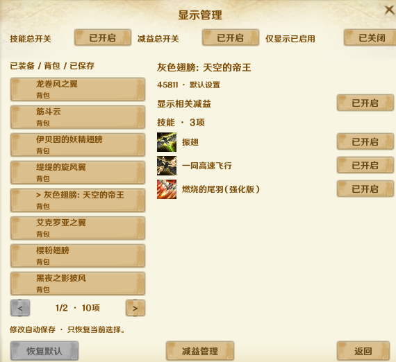</a>
</p>

<picture></picture> **下载**

**Panoptes 1.8**

[](https://github.com/Yunxei/jingxia/releases/download/panoptes-v1.8/Panoptes-1.8.zip)&nbsp;&nbsp;[](https://wwaxb.lanzouc.com/ibmOJ4dx0ade)（提取码：8888）

<picture></picture> **前置插件**

[](https://github.com/Yunxei/jingxia/releases/download/globals/globals.zip)&nbsp;&nbsp;[](https://wwaxb.lanzouc.com/ijXkN4d3or7e)（提取码：8888）

第一次安装需要同时安装 globals；已经安装过则无需重复安装。

<picture></picture> **更新记录**

`1.8`

- 新增自身双抗显示，支持颜色、字号、位置调整及拖动预览。
- 支持跟随人物或固定位置，加入平滑跟随。
- 修复状态图标消失前短暂闪现绿／红底框的问题。

<details>
<summary>历史版本</summary>

`1.7`

- 新增死亡回顾，支持伤害记录、他人施加的减益及显示设置。
- 为增益、减益图标补充原生边框，优化图标内中文倒计时。
- 优化自身图标跟随，减少移动抖动。
- 修复切换目标时短暂残留上一目标信息的问题。
- 补充非全身套装的甲类型状态识别。

`1.6`

- 修复部分旧格式追踪清单无法自动迁移的问题。
- 历史列表支持显示已保存的追踪及重要提示条目。
- 修复已保存状态在历史列表中显示问号图标的问题。

`1.5` · 2026-10-15

- 新增滑翔翼技能冷却与相关减益追踪。
- 新增滑翔翼显示管理、手动启用与减益池管理。
- 新增装备图标固定／跟随模式及拖动预览。
- 个人配置统一保存至插件目录，自动迁移旧配置。
- 修复自身与目标重要提示位置反复互换的问题。

`1.4` · 2026-10-14

- 新增目标连线。
- 新增装备图标自动靠拢。
- 新增设置帮助说明。

`1.3` · 2026-10-04

历史版本。

</details>

</details>

<hr>

<details>
<summary>packratio 3.2 ｜ 多路线货率与贸易提醒</summary>

<a id="packratio"></a>

<picture></picture> **插件说明**

用于查询地区贸易货率、管理路线及显示相关提醒。

<picture></picture> **主要功能**

- 单条路线/多路线货率显示，最多五条
- 货率文本输出与货物售价估算
- 路线收藏、默认路线与组合
- 卷轴过期与载具认主提醒

<p>
  <a href="https://raw.githubusercontent.com/Yunxei/jingxia/main/assets/screenshots/packratio/preview-01.png"></a>
  <a href="https://raw.githubusercontent.com/Yunxei/jingxia/main/assets/screenshots/packratio/preview-02.png"></a>
  <a href="https://raw.githubusercontent.com/Yunxei/jingxia/main/assets/screenshots/packratio/preview-03.png"></a>
</p>

<p>
  <a href="https://raw.githubusercontent.com/Yunxei/jingxia/main/assets/screenshots/packratio/preview-04.png"></a>
</p>

<picture></picture> **下载**

**packratio 3.2**

[](https://github.com/Yunxei/jingxia/releases/download/packratio-v3.2/packratio-3.2.zip)&nbsp;&nbsp;[](https://wwaxb.lanzouc.com/iXJeO4dti42b)（提取码：8888）

<picture></picture> **更新记录**

`3.2`

- 爆仓时仍显示货率刷新地区，同档地区并列显示。
- 地区文字支持换行，不再截断。
- 支持读取查询前已打开的交易所列表。
- 货率详情支持独立缩放，“弹窗”改为“通用窗口”。
- 明细不全时保留已识别地区；过期库存保留显示，暂停相关计算。

<details>
<summary>历史版本</summary>

`3.1`

- 新增货率刷新地区顺序预估，支持三类货物切换，最多显示三个地区。
- 地区名称绿色显示，按排列顺序逐渐降低透明度。

`3.0`

- 新增货率详情，支持调整经商熟练度并实时估价。
- 新增各交易所分类库存记录、交货需求计算和农神宝典。
- 重新设计更多设置界面。
- 配置统一保存至 `config.txt`，兼容旧版自动迁移。
- 修复翡翠谷部分估价、库存过期及位置保存问题，稳定提醒检查频率。

`2.9`

- 新增多路线货率显示，最多同时显示五条。
- 新增路线组合收藏、加载及默认设置。
- 新增查询倒计时、状态显示和超时恢复。
- 新增收藏路线向下排序、帮助说明及右上角关闭按钮。
- 优化组合加载，保留相同路线已有的货率数据。
- 恢复进入游戏时预查询顶部路线，改善首次显示速度。
- 修正刷新顺序，优化排间距及状态按钮对齐。
- 移除聊天查询指令。

`2.8` · 2026-10-05

- 优化锁车识别，现在当前目标和关注目标中的载具都能正常检测认主状态。
- 新增认主倒计时缓存：检测到载具认主剩余时间后，即使取消目标或切换到其他目标，认主倒计时也会继续显示。
- 认主倒计时结束后会继续显示“载具认主已失效”10 秒，随后自动清除提示。
- 优化卷轴过期提醒：卷轴过期后，如果连续 120 秒没有背货，提示会自动清除；重新背货后会取消清除计时。
- 完善屏幕提示设置：支持实时预览、拖动调整位置、修改文字大小和切换黑色描边。
- 屏幕提示的位置、文字大小、颜色和描边设置会自动保存。
- 新增恢复默认，可一键恢复屏幕提示的默认位置、文字大小、颜色和描边。
- 优化设置与管理窗口的操作方式：进入下一级设置时自动隐藏上一层窗口，关闭后返回上一层。
- 优化屏幕提示设置界面布局，并移除进入游戏时的“成功加载货率插件”提示。

`2.7`

历史版本。

</details>

</details>

<hr>

<details>
<summary>speedometer 2.2 ｜ 速度显示</summary>

<a id="speedometer"></a>

<picture></picture> **插件说明**

用于显示载具及步行、坐骑、滑翔翼的移动速度，共用一个可自定义的速度表。

<picture></picture> **主要功能**

- 载具、步行、坐骑与滑翔翼速度显示
- 载具与非载具显示独立开关
- 载具转向数值与左右箭头

<p>
  <a href="https://raw.githubusercontent.com/Yunxei/jingxia/main/assets/screenshots/speedometer/preview-01.png"></a>
  <a href="https://raw.githubusercontent.com/Yunxei/jingxia/main/assets/screenshots/speedometer/preview-02.png"></a>
</p>

<picture></picture> **下载**

**speedometer 2.2**

[](https://github.com/Yunxei/jingxia/releases/download/speedometer-v2.2/speedometer-2.2.zip)&nbsp;&nbsp;[](https://wwaxb.lanzouc.com/irmp74d3ou7c)（提取码：8888）

<picture></picture> **前置插件**

[](https://github.com/Yunxei/jingxia/releases/download/globals/globals.zip)&nbsp;&nbsp;[](https://wwaxb.lanzouc.com/ijXkN4d3or7e)（提取码：8888）

第一次安装需要同时安装 globals；已经安装过则无需重复安装。

<picture></picture> **更新记录**

`2.2` · 2026-10-09

- 恢复载具转向数值及左右箭头显示。
- 倒车时速度显示为正数，不再出现负号。

<details>
<summary>历史版本</summary>

`2.1` · 2026-10-05

- 新增步行、坐骑和滑翔翼速度显示，默认关闭，可在设置中开启。
- 载具与非载具拥有独立显示开关，重进游戏后保留选择。
- 共用一个速度表，仅显示一位小数的速度数字，移除“移动”和单位文字。
- 重做速度表设置界面，布局更紧凑，各行居中排列。
- 打开设置即可实时预览，直接拖动预览调整屏幕位置。
- 文字大小、颜色和黑色描边实时生效，位置与外观自动保存。
- 统一为一个“恢复默认”，只重置位置与外观，不改变显示开关。

`2.0`

历史版本。

</details>

</details>

<hr>

<details>
<summary>ReloadButton 1.0 ｜ 快速重载插件</summary>

<a id="reloadbutton"></a>

<picture></picture> **插件说明**

在 ESC 菜单中提供重新加载插件的快捷入口。

<picture></picture> **主要功能**

- ESC 菜单快捷重载入口
- 10 秒重复操作冷却

<p>
  <a href="https://raw.githubusercontent.com/Yunxei/jingxia/main/assets/screenshots/ReloadButton/preview-01.png"></a>
</p>

<picture></picture> **下载**

**ReloadButton 1.0**

[](https://github.com/Yunxei/jingxia/releases/download/reloadbutton-v1.0/ReloadButton-1.0.zip)&nbsp;&nbsp;[](https://wwaxb.lanzouc.com/i65YP4d3ourc)（提取码：8888）

<picture></picture> **更新记录**

`1.0`

当前正式发布版本。

</details>

<hr>

<details>
<summary>Nyxaria 2.2 ｜ 背包整理</summary>

<a id="nyxaria"></a>

<picture></picture> **插件说明**

用于辅助背包与仓库整理，并提供物品保护及拍卖收藏功能。

<picture></picture> **主要功能**

- 背包物品转存到仓库或随身保管箱
- 物品保护清单与保留数量设置
- 整理快捷键
- 拍卖收藏

<p>
  <a href="https://raw.githubusercontent.com/Yunxei/jingxia/main/assets/screenshots/Nyxaria/preview-01.png"></a>
  <a href="https://raw.githubusercontent.com/Yunxei/jingxia/main/assets/screenshots/Nyxaria/preview-02.png"></a>
  <a href="https://raw.githubusercontent.com/Yunxei/jingxia/main/assets/screenshots/Nyxaria/preview-03.png"></a>
</p>

<p>
  <a href="https://raw.githubusercontent.com/Yunxei/jingxia/main/assets/screenshots/Nyxaria/preview-04.png"></a>
</p>

<picture></picture> **下载**

**Nyxaria 2.2**

[](https://github.com/Yunxei/jingxia/releases/download/nyxaria-v2.2/Nyxaria-2.2.zip)&nbsp;&nbsp;[](https://wwaxb.lanzouc.com/iR6cB4d64baj)（提取码：8888）

<picture></picture> **更新记录**

`2.2`

- 支持 PocketSorter 旧配置静默迁移，保留已有 Nyxaria 配置。

从旧版升级后，请在角色选择界面的插件列表中，同时勾选 Nyxaria 和 pocketsorter，进入角色后会自动迁移原有设置。

<details>
<summary>历史版本</summary>

`2.1`

修复保管箱关闭后透明窗口遮挡鼠标点击的问题。默认整理间隔调整为100ms，保留已有个人设置。

`2.0`

历史版本。

</details>

</details>

<hr>

<details>
<summary>combatcloset 2.8 ｜ 装备与称号一键切换</summary>

<a id="combatcloset"></a>

<picture></picture> **插件说明**

用于保存和切换装备套装与称号及相关快捷设置。

<picture></picture> **主要功能**

- 装备套装与称号保存、切换
- 根据装备属性与镶嵌宝石匹配待换装备
- 熟练度时装忘穿戴提醒
- 切换套装快捷键

<p>
  <a href="https://raw.githubusercontent.com/Yunxei/jingxia/main/assets/screenshots/combatcloset/preview-01.png"></a>
  <a href="https://raw.githubusercontent.com/Yunxei/jingxia/main/assets/screenshots/combatcloset/preview-02.png"></a>
  <a href="https://raw.githubusercontent.com/Yunxei/jingxia/main/assets/screenshots/combatcloset/preview-03.png"></a>
</p>

<picture></picture> **下载**

**combatcloset 2.8**

[](https://github.com/Yunxei/jingxia/releases/download/combatcloset-v2.8/combatcloset-2.8.zip)&nbsp;&nbsp;[](https://wwaxb.lanzouc.com/iYIbD4dpw2qd)（提取码：8888）

<picture></picture> **更新记录**

`2.8`

- 针对官方于 2026.10.28 调整装备名称进行兼容更新。
- 换装时自动更新旧套装记录，减少以后装备改名造成的缺失问题。
- 修复快捷键冲突、同名方案冲突及部分装备状态判断问题。
- 加强配置保存保护，优化换装重试、界面交互与提醒性能。

<details>
<summary>历史版本</summary>

`2.7`

- 修复保存方案后设置列表未立即更新的问题。

`2.6`

- 修复同名装备镶嵌不同宝石时，换装错误选择背包前方装备的问题。
- 已穿戴判断和套装状态识别同步校验宝石签名。
- 兼容现有套装配置，无需重新保存。

`2.5`

- 优化设置与管理窗口：进入下一级时自动隐藏上一层，关闭、取消或按 ESC 后返回上一层。
- 「熟练度时装未穿戴」提示新增实时预览，可直接拖动调整屏幕位置。
- 新增文字大小调整和黑色描边开关，描边默认开启。
- 提示位置、文字大小、颜色和描边选择会自动保存。
- 新增恢复默认，只恢复提示外观，不影响套装、提醒延迟和其他设置。

</details>

</details>

<hr>

<details>
<summary>Angler 1.1 ｜ 钓鱼辅助</summary>

<a id="angler"></a>

<picture></picture> **插件说明**

钓鱼辅助插件，显示当前鱼的动作、较劲、生命值与距离，并记录带头顶标记的死鱼剩余拾取时间。

<picture></picture> **主要功能**

- 鱼的动作与较劲状态显示
- 带头顶标记的死鱼拾取倒计时（150 秒）
- 鱼的生命值与距离显示
- 较劲与拾取倒计时颜色提示
- 可选悬浮窗

<p>
  <a href="https://raw.githubusercontent.com/Yunxei/jingxia/main/assets/screenshots/angler/preview-01.png"></a>
  <a href="https://raw.githubusercontent.com/Yunxei/jingxia/main/assets/screenshots/angler/preview-02.png"></a>
</p>

<picture></picture> **下载**

**Angler 1.1**

[](https://github.com/Yunxei/jingxia/releases/download/angler-v1.1/Angler-1.1.zip)&nbsp;&nbsp;[](https://wwaxb.lanzouc.com/iEXrp4d5o8kf)（提取码：8888）

<picture></picture> **前置插件**

[](https://github.com/Yunxei/jingxia/releases/download/globals/globals.zip)&nbsp;&nbsp;[](https://wwaxb.lanzouc.com/ijXkN4d3or7e)（提取码：8888）

第一次安装需要同时安装 globals；已经安装过则无需重复安装。

<picture></picture> **更新记录**

`1.1`

- 仅在装备激活鱼竿时启动钓鱼检测，减少重复刷新。
- 捡鱼倒计时调整为 150 秒，并按剩余时间排序。
- 修复动作结束后图标和倒计时残留、死鱼计时重复启动等问题。
- 调整死鱼图标居中显示。
- 设置窗口新增运行状态，优化默认布局与位置保存。

<details>
<summary>历史版本</summary>

`1.0`

历史版本。

</details>

</details>

<hr>

<details>
<summary>Astravia 1.5 ｜ 地图与点位导航</summary>

<a id="astravia"></a>

<picture></picture> **插件说明**

用于地图、资源与自定义点位导航。

内置地图 63 张，点位坐标 ≈4500 个。

地图与图标素材 ≈21.6MB，代码及坐标数据 ≈2.5MB。

插件体积主要来自素材，文件大小不等同于运行时性能开销。

<picture></picture> **主要功能**

- 沉船、藏宝图、探索点、海虫点及自定义点位导航
- 种植、采集、伐木、采矿、领地资源点、首领与保管箱成就分类筛选
- 陈旧的坛子、遗物箱、探险家的背包及打捞、信物点位查询
- 自定义点位导入、当前位置记录、名称与备注管理
- 地图定位、最近传送点推荐及坐标、名称复制
- 仙境各类活动宝箱以及探险点位

<p>
  <a href="https://raw.githubusercontent.com/Yunxei/jingxia/main/assets/screenshots/Astravia/preview-01.png"></a>
  <a href="https://raw.githubusercontent.com/Yunxei/jingxia/main/assets/screenshots/Astravia/preview-02.png"></a>
  <a href="https://raw.githubusercontent.com/Yunxei/jingxia/main/assets/screenshots/Astravia/preview-03.png"></a>
</p>

<p>
  <a href="https://raw.githubusercontent.com/Yunxei/jingxia/main/assets/screenshots/Astravia/preview-04.png"></a>
  <a href="https://raw.githubusercontent.com/Yunxei/jingxia/main/assets/screenshots/Astravia/preview-05.png">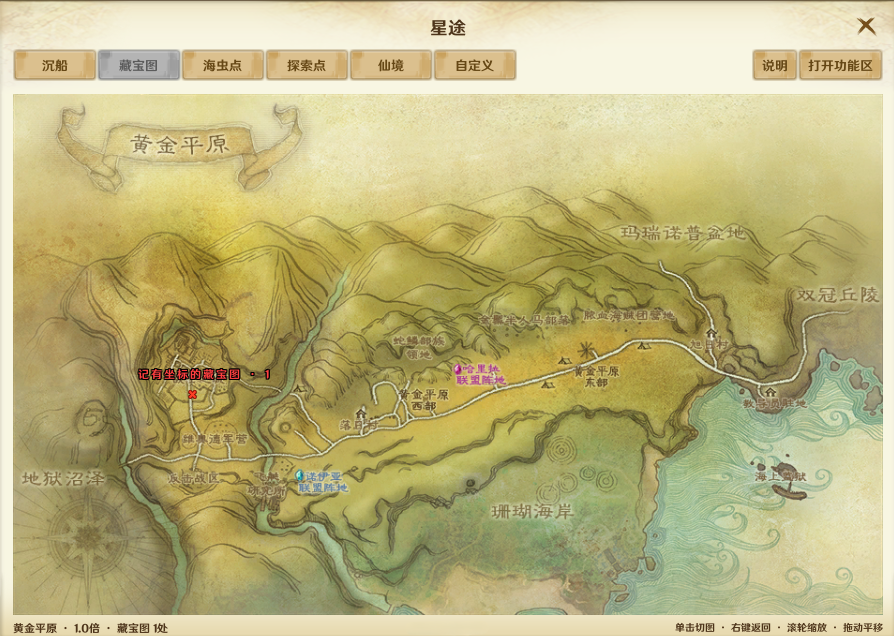</a>
  <a href="https://raw.githubusercontent.com/Yunxei/jingxia/main/assets/screenshots/Astravia/preview-06.png">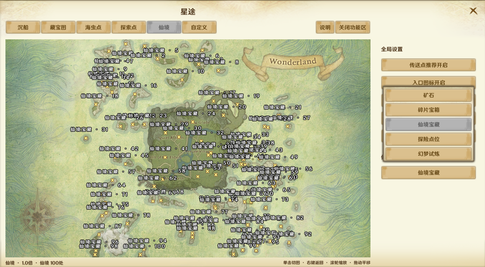</a>
</p>

<p>
  <a href="https://raw.githubusercontent.com/Yunxei/jingxia/main/assets/screenshots/Astravia/preview-07.png">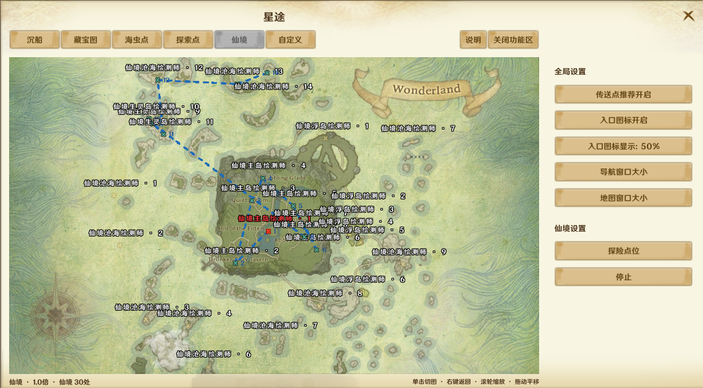</a>
  <a href="https://raw.githubusercontent.com/Yunxei/jingxia/main/assets/screenshots/Astravia/preview-08.png">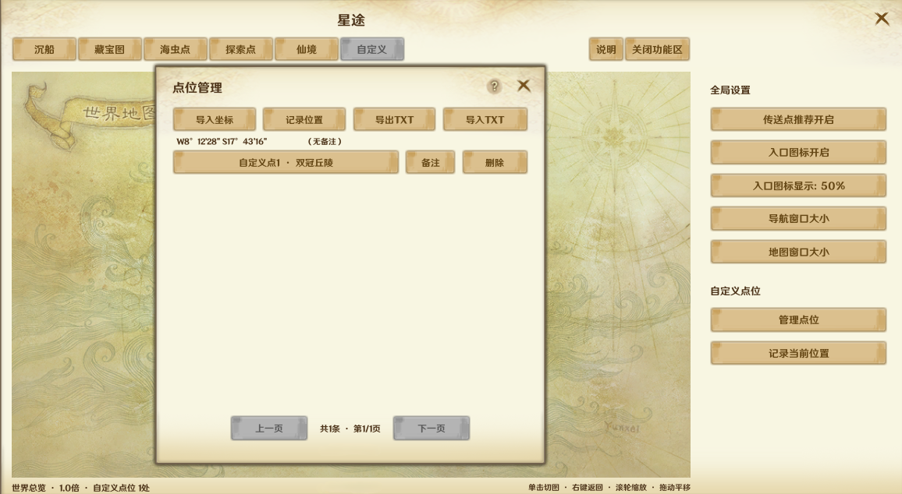</a>
  <a href="https://raw.githubusercontent.com/Yunxei/jingxia/main/assets/screenshots/Astravia/preview-09.png">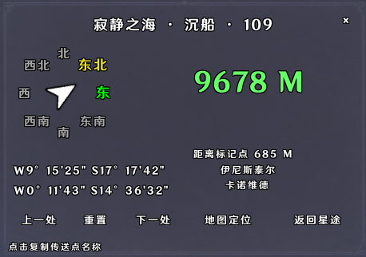</a>
</p>

<picture></picture> **下载**

**Astravia 1.5**

[](https://github.com/Yunxei/jingxia/releases/download/astravia-v1.5/Astravia-1.5.zip)&nbsp;&nbsp;[](https://wwaxb.lanzouc.com/i7Qyg4d5p3qh)（提取码：8888）

**升级轻量包**

[](https://github.com/Yunxei/jingxia/releases/download/astravia-v1.5/Astravia-1.5-Update.zip)&nbsp;&nbsp;[](https://wwaxb.lanzouc.com/iyQhU4d5p5ve)（提取码：8888）

仅供已安装 Astravia 1.3 或 1.4 完整版的用户覆盖升级；新装请下载完整版。

<picture></picture> **前置插件**

[](https://github.com/Yunxei/jingxia/releases/download/globals/globals.zip)&nbsp;&nbsp;[](https://wwaxb.lanzouc.com/ijXkN4d3or7e)（提取码：8888）

第一次安装需要同时安装 globals；已经安装过则无需重复安装。

<picture></picture> **更新记录**

`1.5`

- 新增传送点“[副本]王宫下水道”。
- 探索新增“西大角色传送点”筛选，收录全部大陆的 139 个据点，方便查漏补缺。
- 补齐千年树精拉文、风之君主、迷途彷徨者遗漏的跨地区出生点。

<details>
<summary>历史版本</summary>

`1.4`

- 新增保管箱成就分类，包含 8 个点位及坐骑保管箱、战宠保管箱筛选。
- 优化探索点悬停名称的显示层级与刷新表现。
- 新增重复点击当前点位取消导航并关闭窗口，保留完成进度。

`1.3`

- 新增仙境地图及矿石、碎片宝箱、仙境宝藏、探险点位、幻梦试炼分类。
- 新增探险路线高亮、完成状态及按顺序接续导航。
- 补充首领坐标，首领点位增至34处，移除首领编号。
- 更新仙境点位，支持名称显示及备注查看。
- 修复自定义点位保存、翻页显示及地区归属问题。
- 配置统一保存至插件目录，兼容旧数据并静默迁移。
- 优化分类菜单、导航信息及说明窗口。

`1.3 Beta`

- 新增自定义点位：导入坐标、记录当前位置、修改名称和备注、分页管理、删除及导航，点位可保存。
- 新增分类菜单及独立筛选，默认全选，支持全选／全取消及分页。
- 新增种植、采集、伐木、采矿、领地资源点，共3183处。
- 新增龟船打捞点、呼吸耳环信物及呼吸耳环信物Boss房间，共17处。
- 新增首领分类，共15处，包含纳扎尔。
- 新增40条传送点，移除王宫下水道。
- 修复4处已有传送点的坐标及归属数据。
- 优化罗盘：绿色突出主方向，辅助方向渐变，字号随方向变化。
- 优化点位编号：探索、资源和首领按种类、地图固定编号，筛选不会重新编号。
- 优化探索功能区：移除“导航最近点位”按钮。


`1.2 Beta`

- 新增说明窗口。
- 新增区域名称支持复制。
- 调整导航信息字号与行距。
- 修复选择标记后导航窗口意外位移。
- 修复导航窗口缩放后的贴边位置恢复。
- 修复挖完藏宝图后未自动切换到下一张导航的问题。

`1.1 Beta`

- 修复探索点筛选窗口的闪退问题，调整弹窗位置及全选／全取消操作。
- 调整地图页签间距，功能区向右展开时保持地图位置不变。
- 重进游戏时地图居中，功能区默认收起。
- 新增导航窗口屏幕四边及角落吸附。
- 新增入口图标显示强度设置。
- 新增导航窗口、地图窗口大小设置，支持实时预览和保存。
- ESC 菜单入口改为“地图坐标插件”，使用地图图标。

`1.0 Beta`

历史测试版本。

</details>

</details>

<hr>

<details>
<summary>LayoutKeeper 1.0 ｜ 界面布局保存与迁移</summary>

<a id="layoutkeeper"></a>

<picture></picture> **插件说明**

保存界面布局，供不同角色、账号或电脑使用。

<picture></picture> **主要功能**

- 保存界面位置及缩放比例
- 布局导出与导入

<p>
  <a href="https://raw.githubusercontent.com/Yunxei/jingxia/main/assets/screenshots/LayoutKeeper/preview-01.png"></a>
  <a href="https://raw.githubusercontent.com/Yunxei/jingxia/main/assets/screenshots/LayoutKeeper/preview-02.png"></a>
  <a href="https://raw.githubusercontent.com/Yunxei/jingxia/main/assets/screenshots/LayoutKeeper/preview-03.png"></a>
</p>

<picture></picture> **下载**

**LayoutKeeper 1.0**

[](https://github.com/Yunxei/jingxia/releases/download/layoutkeeper-v1.0/LayoutKeeper-1.0.zip)&nbsp;&nbsp;[](https://wwaxb.lanzouc.com/ip0ev4d3oxkd)（提取码：8888）

<picture></picture> **前置插件**

[](https://github.com/Yunxei/jingxia/releases/download/globals/globals.zip)&nbsp;&nbsp;[](https://wwaxb.lanzouc.com/ijXkN4d3or7e)（提取码：8888）

第一次安装需要同时安装 globals；已经安装过则无需重复安装。

<picture></picture> **更新记录**

`1.0`

当前正式发布版本。

</details>

<hr>

<details>
<summary>Moneta 1.4 ｜ 贸易小账本</summary>

<a id="moneta"></a>

<picture></picture> **插件说明**

用于记录每日交货、追踪待收货款的贸易小账本。

<picture></picture> **主要功能**

- 逐笔交货记录与每日货物数量统计。
- 待收金币、物品奖励和到账倒计时。
- 交货耗劳与每日劳动力增减统计。
- 屏幕金币与物品收益显示。

<p>
  <a href="https://raw.githubusercontent.com/Yunxei/jingxia/main/assets/screenshots/Moneta/preview-01.png">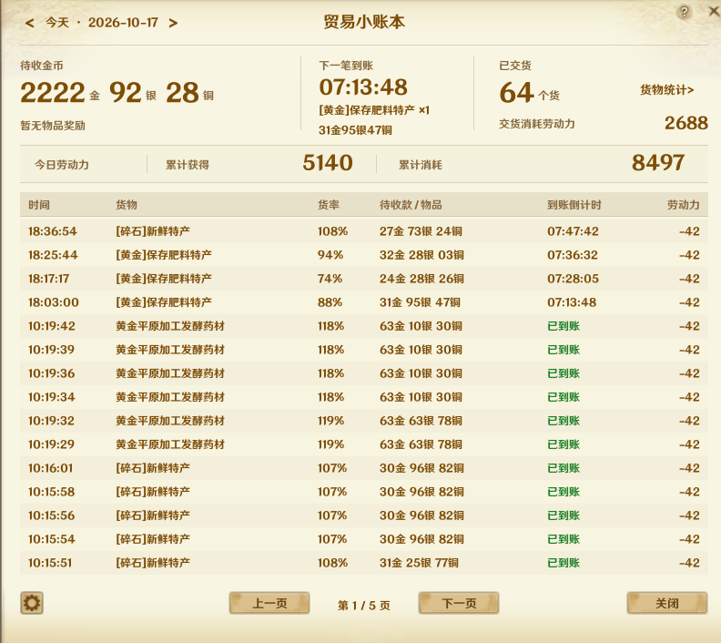</a>
  <a href="https://raw.githubusercontent.com/Yunxei/jingxia/main/assets/screenshots/Moneta/preview-02.png">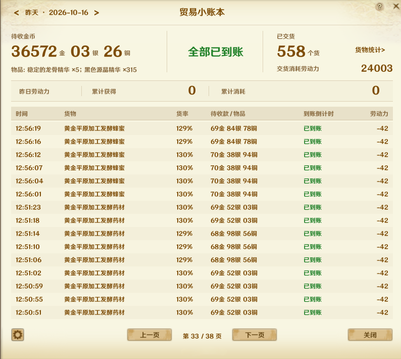</a>
  <a href="https://raw.githubusercontent.com/Yunxei/jingxia/main/assets/screenshots/Moneta/preview-03.png">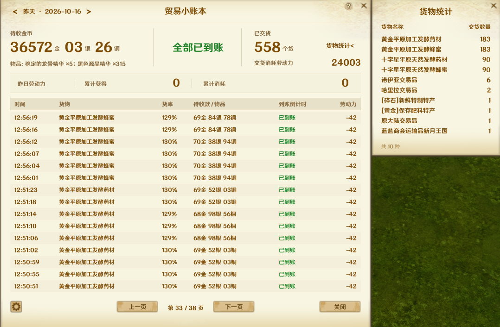</a>
</p>

<picture></picture> **下载**

**Moneta 1.4**

[](https://github.com/Yunxei/jingxia/releases/download/moneta-v1.4/Moneta-1.4.zip)&nbsp;&nbsp;[](https://wwaxb.lanzouc.com/iAVta4d3oxxg)（提取码：8888）

<picture></picture> **前置插件**

[](https://github.com/Yunxei/jingxia/releases/download/globals/globals.zip)&nbsp;&nbsp;[](https://wwaxb.lanzouc.com/ijXkN4d3or7e)（提取码：8888）

第一次安装需要同时安装 globals；已经安装过则无需重复安装。

<picture></picture> **更新记录**

`1.4`

- 新增新鲜度列，显示交货时的新鲜度奖励加成。
- 调整交货列表列宽与间距。
- 主窗口每次进入游戏时居中，拖动位置仅在本次游戏期间保留。
- 设置窗口默认按屏幕居中。

<details>
<summary>历史版本</summary>

`1.3`

- 修复屏幕收益在重新登录或文字长度变化后左右偏移的问题。

`1.2`

- 修复他人制作金币货物的出售分成计算。
- 已保存制作人与分成信息的记录自动重新计算货款。

`1.1`

- 新增屏幕物品收益显示与交货收益提示。
- 按今日交货货物数量选择常驻收益类型，新交货后自动切换，1小时无新交货后恢复。
- 新增窗口大小设置、屏幕收益左键开关及悬停变色。
- 调整窗口拖动、主窗口位置恢复与说明浮窗定位。
- 入口文件统一为 Moneta.lua，兼容原有设置与记录。

`1.0`

首次发布。

</details>

</details>

<hr>

<details>
<summary>DenyList 1.1 ｜ 团队黑名单</summary>

<a id="denylist"></a>

<picture></picture> **插件说明**

检查团队中的黑名单成员，提供提醒和自动踢出功能，自动踢出需要团队管理权限。

<picture></picture> **主要功能**

- 公会、个人黑名单管理
- 团队黑名单浮窗与系统提示
- 自动踢出黑名单成员

<p>
  <a href="https://raw.githubusercontent.com/Yunxei/jingxia/main/assets/screenshots/DenyList/preview-01.png">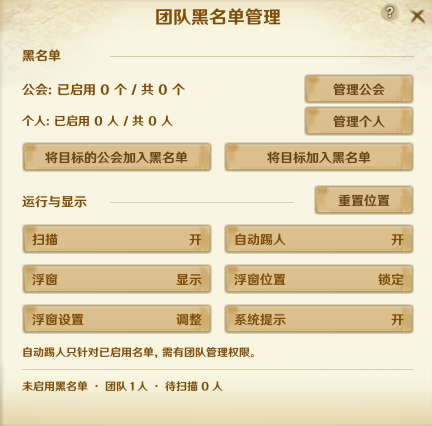</a>
  <a href="https://raw.githubusercontent.com/Yunxei/jingxia/main/assets/screenshots/DenyList/preview-02.png">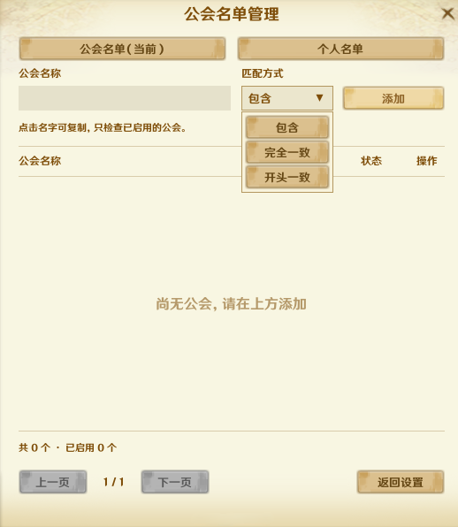</a>
  <a href="https://raw.githubusercontent.com/Yunxei/jingxia/main/assets/screenshots/DenyList/preview-03.png">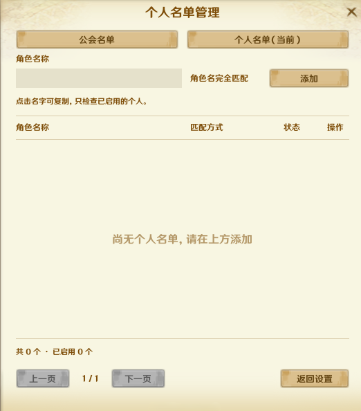</a>
</p>

<picture></picture> **下载**

**DenyList 1.1**

[](https://github.com/Yunxei/jingxia/releases/download/denylist-v1.1/DenyList-1.1.zip)&nbsp;&nbsp;[](https://wwaxb.lanzouc.com/i5N6d4d3oy6f)（提取码：8888）

<picture></picture> **更新记录**

`1.1`

- 新增名单页面从当前目标添加。
- 支持按住加减及翻页按钮连续操作。
- 修复名单文字显示、悬停与点击复制问题。
- 修复浮窗字号、描边及背景尺寸适配。
- 完善自动踢人队列，新增暂停重试与权限恢复检测。
- 完善配置保存恢复、窗口位置及界面提示。
- 补充公会与个人名单的识别距离说明。

<details>
<summary>历史版本</summary>

`1.0`

首次发布。

</details>

</details>

<hr>

<details>
<summary>Tabula 1.0 ｜ 每日债券需求</summary>

<a id="tabula"></a>

<picture></picture> **插件说明**

汇总各大陆居民公告板的债券所需物资与钱袋需求。

<picture></picture> **主要功能**

- 东大陆、西大陆、原大陆物资需求
- 地区名称复制

<p>
  <a href="https://raw.githubusercontent.com/Yunxei/jingxia/main/assets/screenshots/Tabula/preview-01.png">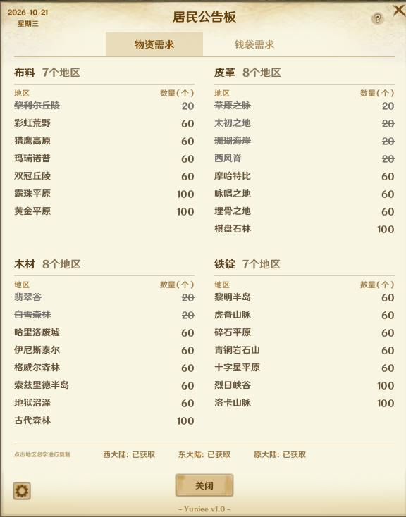</a>
</p>

<picture></picture> **下载**

**Tabula 1.0**

[](https://github.com/Yunxei/jingxia/releases/download/tabula-v1.0/Tabula-1.0.zip)&nbsp;&nbsp;[](https://wwaxb.lanzouc.com/ijMxk4d3oz5a)（提取码：8888）

<picture></picture> **前置插件**

[](https://github.com/Yunxei/jingxia/releases/download/globals/globals.zip)&nbsp;&nbsp;[](https://wwaxb.lanzouc.com/ijXkN4d3or7e)（提取码：8888）

第一次安装需要同时安装 globals；已经安装过则无需重复安装。

<picture></picture> **更新记录**

`1.0`

首次发布。

</details>

<hr>

<details>
<summary>FieldNotes 1.1 ｜ 信息概况</summary>

<a id="fieldnotes"></a>

<picture></picture> **插件说明**

汇总每日收支、任务进度与活动信息。

<picture></picture> **主要功能**

- 每日资源收支与昨日总览
- 每日、周常任务进度与奖励
- 特殊活动排期与明日预告
- 债券物资需求与副本信息
- 屏幕收益提示

<p>
  <a href="https://raw.githubusercontent.com/Yunxei/jingxia/main/assets/screenshots/FieldNotes/preview-01.png">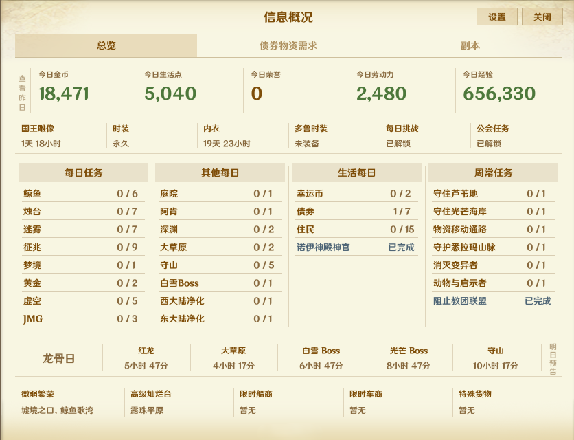</a>
  <a href="https://raw.githubusercontent.com/Yunxei/jingxia/main/assets/screenshots/FieldNotes/preview-02.png">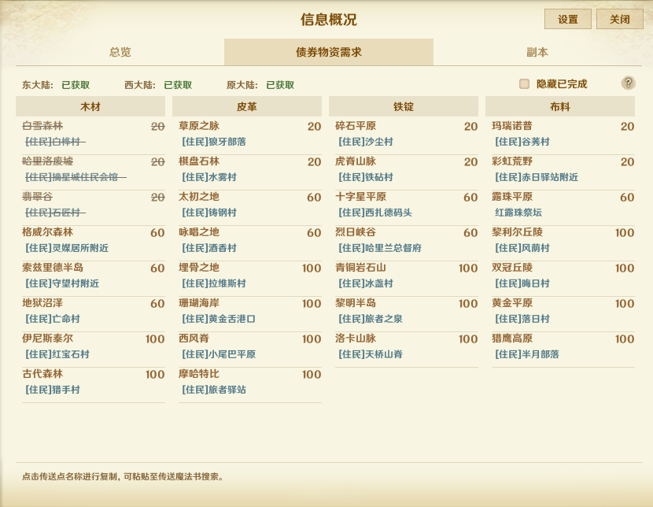</a>
  <a href="https://raw.githubusercontent.com/Yunxei/jingxia/main/assets/screenshots/FieldNotes/preview-03.png">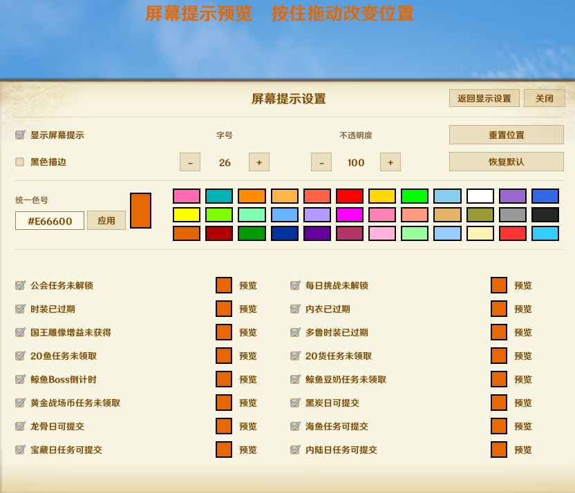</a>
</p>

<picture></picture> **下载**

**FieldNotes 1.1**

[](https://github.com/Yunxei/jingxia/releases/download/fieldnotes-v1.1/FieldNotes-1.1.zip)&nbsp;&nbsp;[](https://wwaxb.lanzouc.com/iM1lg4d5ozeb)（提取码：8888）

<picture></picture> **前置插件**

[](https://github.com/Yunxei/jingxia/releases/download/globals/globals.zip)&nbsp;&nbsp;[](https://wwaxb.lanzouc.com/ijXkN4d3or7e)（提取码：8888）

第一次安装需要同时安装 globals；已经安装过则无需重复安装。

<picture></picture> **更新记录**

`1.1`

- 修复屏幕提示文字连在一起的问题，调整提示间距。
- 去掉鲸鱼Boss名称与倒计时之间的空格。

<details>
<summary>历史版本</summary>

`1.0`

首次发布。

</details>

</details>
