## 插件目录 <sub><a href="#user-content-installation">安装说明</a></sub>

| 插件 | 当前版本 | 更新时间 | 简介 | 下载 | 前置插件 |
| --- | --- | --- | --- | --- | --- |
| [globals](#user-content-globals) | — | — | 前置插件 | [](https://github.com/Yunxei/jingxia/releases/download/globals/globals.zip) | — |
| [TimeUntil](#user-content-timeuntil) | 5.0 | 2026-10-11 | 活动/地区时间 | [](https://github.com/Yunxei/jingxia/releases/download/timeuntil-v5.0/TimeUntil-5.0.zip) | globals |
| [Panoptes](#user-content-panoptes) | 1.5 | 2026-10-15 | 玩家状态追踪 | [](https://github.com/Yunxei/jingxia/releases/download/panoptes-v1.5/Panoptes-1.5.zip) | globals |
| [packratio](#user-content-packratio) | 2.9 | 2026-10-13 | 多路线货率与贸易提醒 | [](https://github.com/Yunxei/jingxia/releases/download/packratio-v2.9/packratio-2.9.zip) | — |
| [speedometer](#user-content-speedometer) | 2.2 | 2026-10-09 | 速度显示 | [](https://github.com/Yunxei/jingxia/releases/download/speedometer-v2.2/speedometer-2.2.zip) | globals |
| [ReloadButton](#user-content-reloadbutton) | 1.0 | 2026-10-04 | 快速重载插件 | [](https://github.com/Yunxei/jingxia/releases/download/reloadbutton-v1.0/ReloadButton-1.0.zip) | — |
| [Nyxaria](#user-content-nyxaria) | 2.1 | 2026-10-07 | 背包整理 | [](https://github.com/Yunxei/jingxia/releases/download/nyxaria-v2.1/Nyxaria-2.1.zip) | — |
| [combatcloset](#user-content-combatcloset) | 2.7 | 2026-10-14 | 装备与称号一键切换 | [](https://github.com/Yunxei/jingxia/releases/download/combatcloset-v2.7/combatcloset-2.7.zip) | — |
| [Angler](#user-content-angler) | 1.0 | 2026-10-06 | 钓鱼辅助 | [](https://github.com/Yunxei/jingxia/releases/download/angler-v1.0/Angler-1.0.zip) | globals |
| [Astravia](#user-content-astravia) | 1.3 Beta | 2026-10-11 | 地图、资源与点位导航 | [](https://github.com/Yunxei/jingxia/releases/download/astravia-v1.3-beta/Astravia-1.3-Beta.zip) | globals |
| [LayoutKeeper](#user-content-layoutkeeper) | 1.0 | 2026-10-13 | 界面布局保存与迁移 | [](https://github.com/Yunxei/jingxia/releases/download/layoutkeeper-v1.0/LayoutKeeper-1.0.zip) | globals |
<br>

> 有BUG或者建议可以联系我，我会第二时间更新，因为第一时间我要农。

> 点击下方插件详情标题展开详细说明。

<br>

<details>
<summary>安装说明</summary>

<a id="installation"></a>

```text
下载压缩包后解压文件夹，将文件夹放入：
X:\My Documents\ArcheRage\Addon

注意：
X 不是固定盘符，它代表你电脑上“文档”文件夹所在的盘。

不同系统：
• Win10/Win11 中文：文档
• Win7 中文：我的文档
• 英文系统：Documents / My Documents

请不要直接复制 X。

首次安装后：
1. 重新登录游戏，进入角色选择界面。
2. 点击界面右上角的扳手按钮，打开插件列表。
3. 勾选需要启用的插件，然后进入游戏。

更新已安装并启用的插件时，无需再次点击扳手按钮或勾选插件。

需要 globals 的插件，请同时安装 globals。
```

<hr>

**使用与设置**  
进入游戏后，可在 ESC 游戏菜单中打开对应插件的详细设置。  
多数插件支持调整界面位置、大小、字体和颜色，可按个人习惯自由搭配，具体以各插件设置为准。

</details>

<hr>

<details>
<summary>globals ｜ 前置插件</summary>

<a id="globals"></a>

- globals 是部分插件运行所需的前置插件
- 多个插件共用同一个 globals，只需安装一份

<picture></picture> **下载**

**globals**

[](https://github.com/Yunxei/jingxia/releases/download/globals/globals.zip)

</details>

<hr>

<details>
<summary>TimeUntil 5.0 ｜ 活动/地区时间</summary>

<a id="timeuntil"></a>

<picture></picture> **插件说明**

用于查看地区状态、活动时间以及相关倒计时。

<picture></picture> **主要功能**

- 地区和平、纷争、战争时间与倒计时
- 游戏活动时间与倒计时
- 部分活动的任务完成进度
- 自定义活动显示内容与数量

<p>
  <a href="https://raw.githubusercontent.com/Yunxei/jingxia/main/assets/screenshots/TimeUntil/preview-01.png">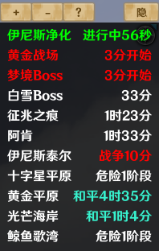</a>
  <a href="https://raw.githubusercontent.com/Yunxei/jingxia/main/assets/screenshots/TimeUntil/preview-02.png">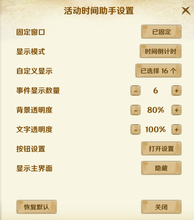</a>
  <a href="https://raw.githubusercontent.com/Yunxei/jingxia/main/assets/screenshots/TimeUntil/preview-03.png">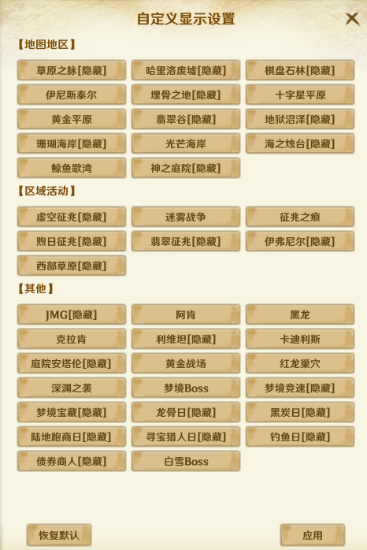</a>
</p>

<picture></picture> **下载**

**TimeUntil 5.0**

[](https://github.com/Yunxei/jingxia/releases/download/timeuntil-v5.0/TimeUntil-5.0.zip)

<picture></picture> **前置插件**

[](https://github.com/Yunxei/jingxia/releases/download/globals/globals.zip)

第一次安装需要同时安装 globals；已经安装过则无需重复安装。

<picture></picture> **更新记录**

`5.0`

修复伊尼斯、十字星进入和平后净化计时仍显示进行中的问题。

<details>
<summary>历史版本</summary>

`4.9`

历史版本。

</details>

</details>

<hr>

<details>
<summary>Panoptes 1.5 ｜ 玩家状态追踪</summary>

<a id="panoptes"></a>

<picture></picture> **插件说明**

用于显示和追踪自身、目标的状态，提供悬浮面板、头顶标记和屏幕提示等辅助显示。

<picture></picture> **主要功能**

- 自身与目标状态、剩余时间及层数追踪
- 悬浮面板与头顶标记
- 目标信息、装备评分与距离显示
- 重要状态屏幕提示与扒皮等级提醒
- 自身装备图标显示
- 大施法条
- 进团时按职业自动设置团队职责
- 目标连线独立开关
- 滑翔翼技能冷却与相关减益追踪

<p>
  <a href="https://raw.githubusercontent.com/Yunxei/jingxia/main/assets/screenshots/Panoptes/preview-01.png">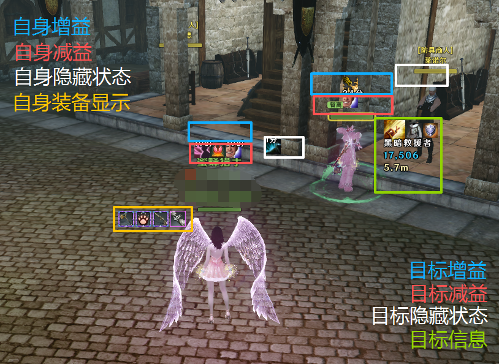</a>
  <a href="https://raw.githubusercontent.com/Yunxei/jingxia/main/assets/screenshots/Panoptes/preview-02.png">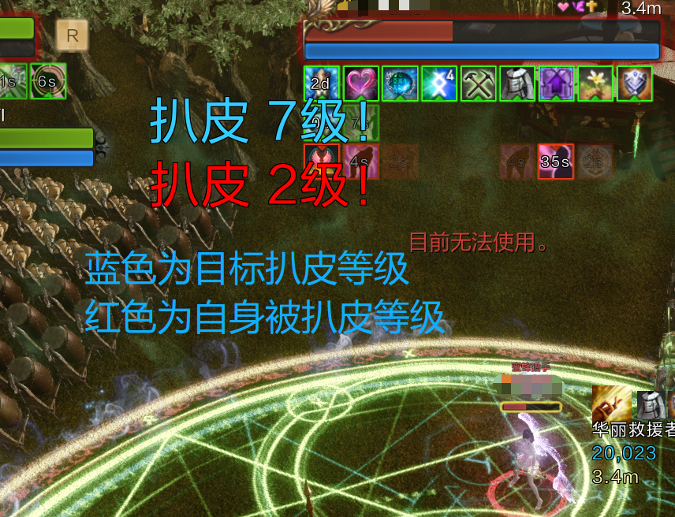</a>
  <a href="https://raw.githubusercontent.com/Yunxei/jingxia/main/assets/screenshots/Panoptes/preview-03.png">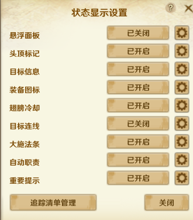</a>
</p>

<p>
  <a href="https://raw.githubusercontent.com/Yunxei/jingxia/main/assets/screenshots/Panoptes/preview-04.png">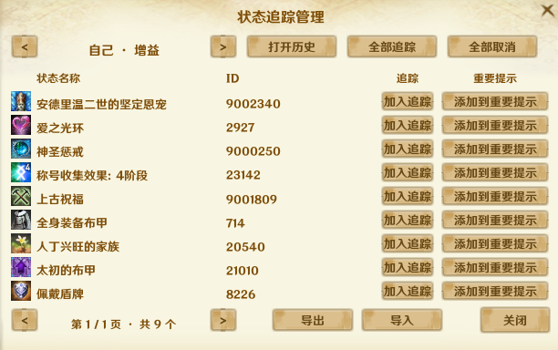</a>
  <a href="https://raw.githubusercontent.com/Yunxei/jingxia/main/assets/screenshots/Panoptes/preview-05.png">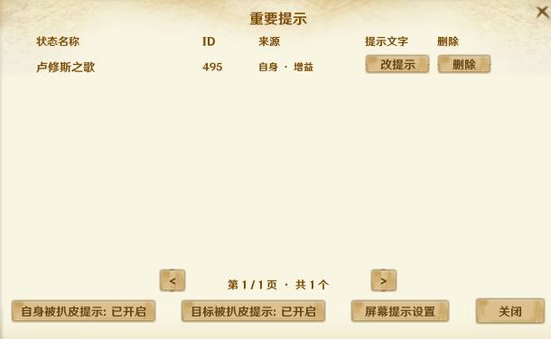</a>
</p>

<picture></picture> **下载**

**Panoptes 1.5**

[](https://github.com/Yunxei/jingxia/releases/download/panoptes-v1.5/Panoptes-1.5.zip)

<picture></picture> **前置插件**

[](https://github.com/Yunxei/jingxia/releases/download/globals/globals.zip)

第一次安装需要同时安装 globals；已经安装过则无需重复安装。

<picture></picture> **更新记录**

`1.5`

- 新增滑翔翼技能冷却与相关减益追踪。
- 新增滑翔翼显示管理、手动启用与减益池管理。
- 新增装备图标固定／跟随模式及拖动预览。
- 个人配置统一保存至插件目录，自动迁移旧配置。
- 修复自身与目标重要提示位置反复互换的问题。

<details>
<summary>历史版本</summary>

`1.4` · 2026-10-14

- 新增目标连线。
- 新增装备图标自动靠拢。
- 新增设置帮助说明。

`1.3` · 2026-10-04

历史版本。

</details>

</details>

<hr>

<details>
<summary>packratio 2.9 ｜ 多路线货率与贸易提醒</summary>

<a id="packratio"></a>

<picture></picture> **插件说明**

用于查询地区贸易货率、管理路线及显示相关提醒。

<picture></picture> **主要功能**

- 单条路线/多路线货率显示，最多五条
- 货率文本输出与货物售价估算
- 路线收藏、默认路线与组合
- 卷轴过期与载具认主提醒

<p>
  <a href="https://raw.githubusercontent.com/Yunxei/jingxia/main/assets/screenshots/packratio/preview-01.png">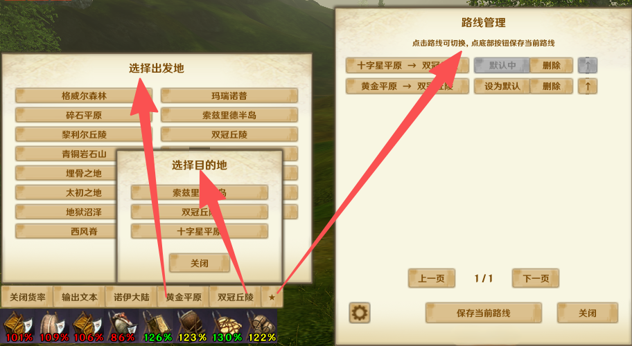</a>
  <a href="https://raw.githubusercontent.com/Yunxei/jingxia/main/assets/screenshots/packratio/preview-02.png">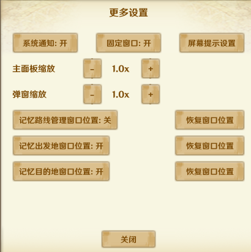</a>
  <a href="https://raw.githubusercontent.com/Yunxei/jingxia/main/assets/screenshots/packratio/preview-03.png">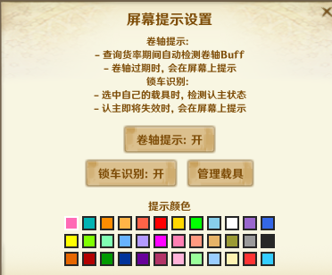</a>
</p>

<p>
  <a href="https://raw.githubusercontent.com/Yunxei/jingxia/main/assets/screenshots/packratio/preview-04.png"></a>
</p>

<picture></picture> **下载**

**packratio 2.9**

[](https://github.com/Yunxei/jingxia/releases/download/packratio-v2.9/packratio-2.9.zip)

<picture></picture> **更新记录**

`2.9`

- 新增多路线货率显示，最多同时显示五条。
- 新增路线组合收藏、加载及默认设置。
- 新增查询倒计时、状态显示和超时恢复。
- 新增收藏路线向下排序、帮助说明及右上角关闭按钮。
- 优化组合加载，保留相同路线已有的货率数据。
- 恢复进入游戏时预查询顶部路线，改善首次显示速度。
- 修正刷新顺序，优化排间距及状态按钮对齐。
- 移除聊天查询指令。

<details>
<summary>历史版本</summary>

`2.8` · 2026-10-05

- 优化锁车识别，现在当前目标和关注目标中的载具都能正常检测认主状态。
- 新增认主倒计时缓存：检测到载具认主剩余时间后，即使取消目标或切换到其他目标，认主倒计时也会继续显示。
- 认主倒计时结束后会继续显示“载具认主已失效”10 秒，随后自动清除提示。
- 优化卷轴过期提醒：卷轴过期后，如果连续 120 秒没有背货，提示会自动清除；重新背货后会取消清除计时。
- 完善屏幕提示设置：支持实时预览、拖动调整位置、修改文字大小和切换黑色描边。
- 屏幕提示的位置、文字大小、颜色和描边设置会自动保存。
- 新增恢复默认，可一键恢复屏幕提示的默认位置、文字大小、颜色和描边。
- 优化设置与管理窗口的操作方式：进入下一级设置时自动隐藏上一层窗口，关闭后返回上一层。
- 优化屏幕提示设置界面布局，并移除进入游戏时的“成功加载货率插件”提示。

`2.7`

历史版本。

</details>

</details>

<hr>

<details>
<summary>speedometer 2.2 ｜ 速度显示</summary>

<a id="speedometer"></a>

<picture></picture> **插件说明**

用于显示载具及步行、坐骑、滑翔翼的移动速度，共用一个可自定义的速度表。

<picture></picture> **主要功能**

- 载具、步行、坐骑与滑翔翼速度显示
- 载具与非载具显示独立开关
- 载具转向数值与左右箭头

<p>
  <a href="https://raw.githubusercontent.com/Yunxei/jingxia/main/assets/screenshots/speedometer/preview-01.png">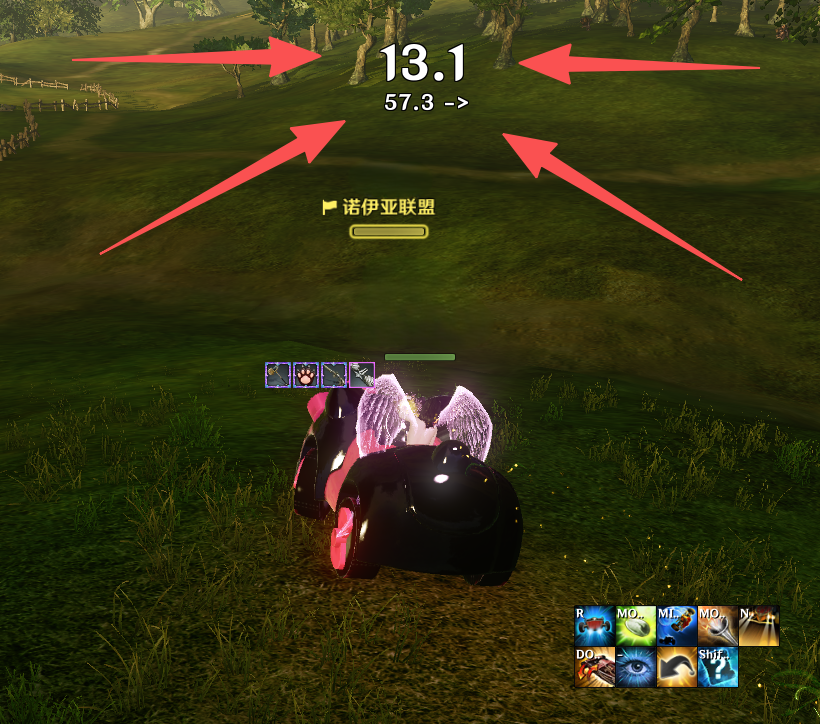</a>
  <a href="https://raw.githubusercontent.com/Yunxei/jingxia/main/assets/screenshots/speedometer/preview-02.png">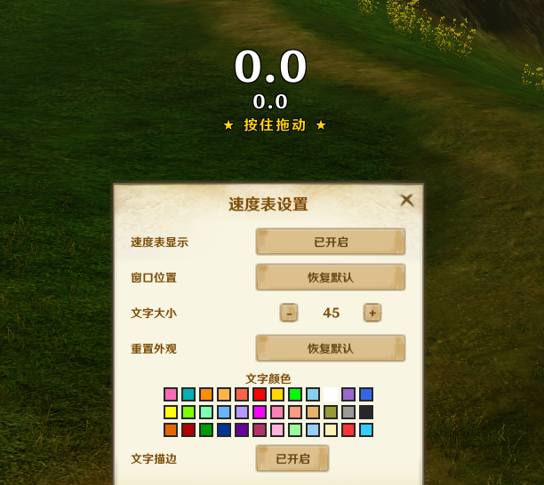</a>
</p>

<picture></picture> **下载**

**speedometer 2.2**

[](https://github.com/Yunxei/jingxia/releases/download/speedometer-v2.2/speedometer-2.2.zip)

<picture></picture> **前置插件**

[](https://github.com/Yunxei/jingxia/releases/download/globals/globals.zip)

第一次安装需要同时安装 globals；已经安装过则无需重复安装。

<picture></picture> **更新记录**

`2.2` · 2026-10-09

- 恢复载具转向数值及左右箭头显示。
- 倒车时速度显示为正数，不再出现负号。

<details>
<summary>历史版本</summary>

`2.1` · 2026-10-05

- 新增步行、坐骑和滑翔翼速度显示，默认关闭，可在设置中开启。
- 载具与非载具拥有独立显示开关，重进游戏后保留选择。
- 共用一个速度表，仅显示一位小数的速度数字，移除“移动”和单位文字。
- 重做速度表设置界面，布局更紧凑，各行居中排列。
- 打开设置即可实时预览，直接拖动预览调整屏幕位置。
- 文字大小、颜色和黑色描边实时生效，位置与外观自动保存。
- 统一为一个“恢复默认”，只重置位置与外观，不改变显示开关。

`2.0`

历史版本。

</details>

</details>

<hr>

<details>
<summary>ReloadButton 1.0 ｜ 快速重载插件</summary>

<a id="reloadbutton"></a>

<picture></picture> **插件说明**

在 ESC 菜单中提供重新加载插件的快捷入口。

<picture></picture> **主要功能**

- ESC 菜单快捷重载入口
- 10 秒重复操作冷却

<p>
  <a href="https://raw.githubusercontent.com/Yunxei/jingxia/main/assets/screenshots/ReloadButton/preview-01.png">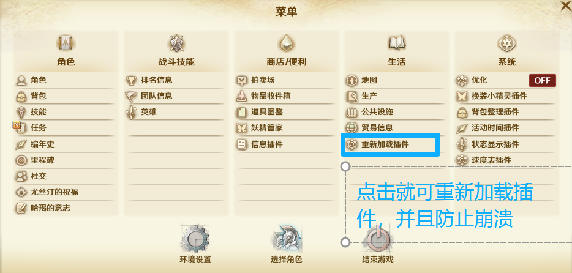</a>
</p>

<picture></picture> **下载**

**ReloadButton 1.0**

[](https://github.com/Yunxei/jingxia/releases/download/reloadbutton-v1.0/ReloadButton-1.0.zip)

<picture></picture> **更新记录**

`1.0`

当前正式发布版本。

</details>

<hr>

<details>
<summary>Nyxaria 2.1 ｜ 背包整理</summary>

<a id="nyxaria"></a>

<picture></picture> **插件说明**

用于辅助背包与仓库整理，并提供物品保护及拍卖收藏功能。

<picture></picture> **主要功能**

- 背包物品转存到仓库或随身保管箱
- 物品保护清单与保留数量设置
- 整理快捷键
- 拍卖收藏

<p>
  <a href="https://raw.githubusercontent.com/Yunxei/jingxia/main/assets/screenshots/Nyxaria/preview-01.png">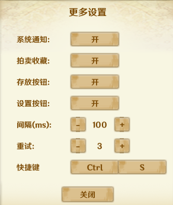</a>
  <a href="https://raw.githubusercontent.com/Yunxei/jingxia/main/assets/screenshots/Nyxaria/preview-02.png">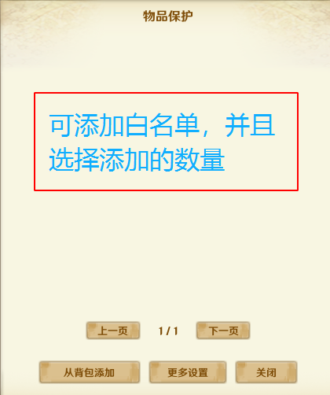</a>
  <a href="https://raw.githubusercontent.com/Yunxei/jingxia/main/assets/screenshots/Nyxaria/preview-03.png">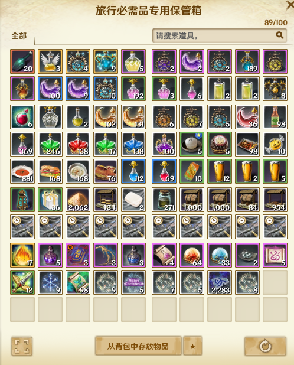</a>
</p>

<p>
  <a href="https://raw.githubusercontent.com/Yunxei/jingxia/main/assets/screenshots/Nyxaria/preview-04.png">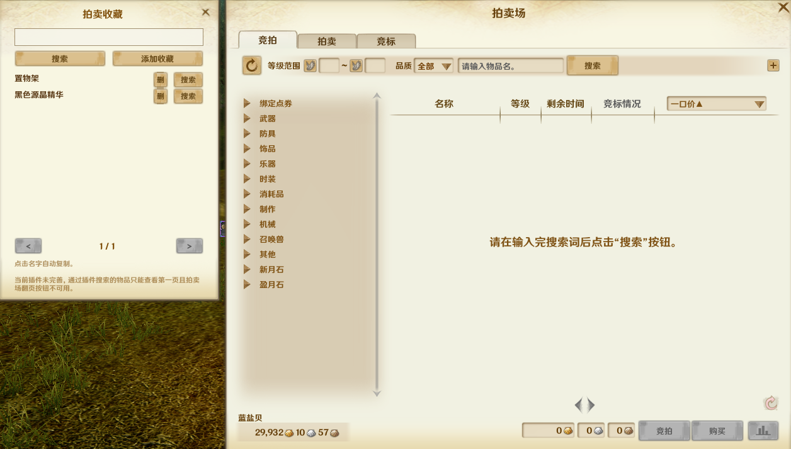</a>
</p>

<picture></picture> **下载**

**Nyxaria 2.1**

[](https://github.com/Yunxei/jingxia/releases/download/nyxaria-v2.1/Nyxaria-2.1.zip)

<picture></picture> **更新记录**

`2.1`

修复保管箱关闭后透明窗口遮挡鼠标点击的问题。默认整理间隔调整为100ms，保留已有个人设置。

<details>
<summary>历史版本</summary>

`2.0`

历史版本。

</details>

</details>

<hr>

<details>
<summary>combatcloset 2.7 ｜ 装备与称号一键切换</summary>

<a id="combatcloset"></a>

<picture></picture> **插件说明**

用于保存和切换装备套装与称号及相关快捷设置。

<picture></picture> **主要功能**

- 装备套装与称号保存、切换
- 根据装备属性与镶嵌宝石匹配待换装备
- 熟练度时装忘穿戴提醒
- 切换套装快捷键

<p>
  <a href="https://raw.githubusercontent.com/Yunxei/jingxia/main/assets/screenshots/combatcloset/preview-01.png">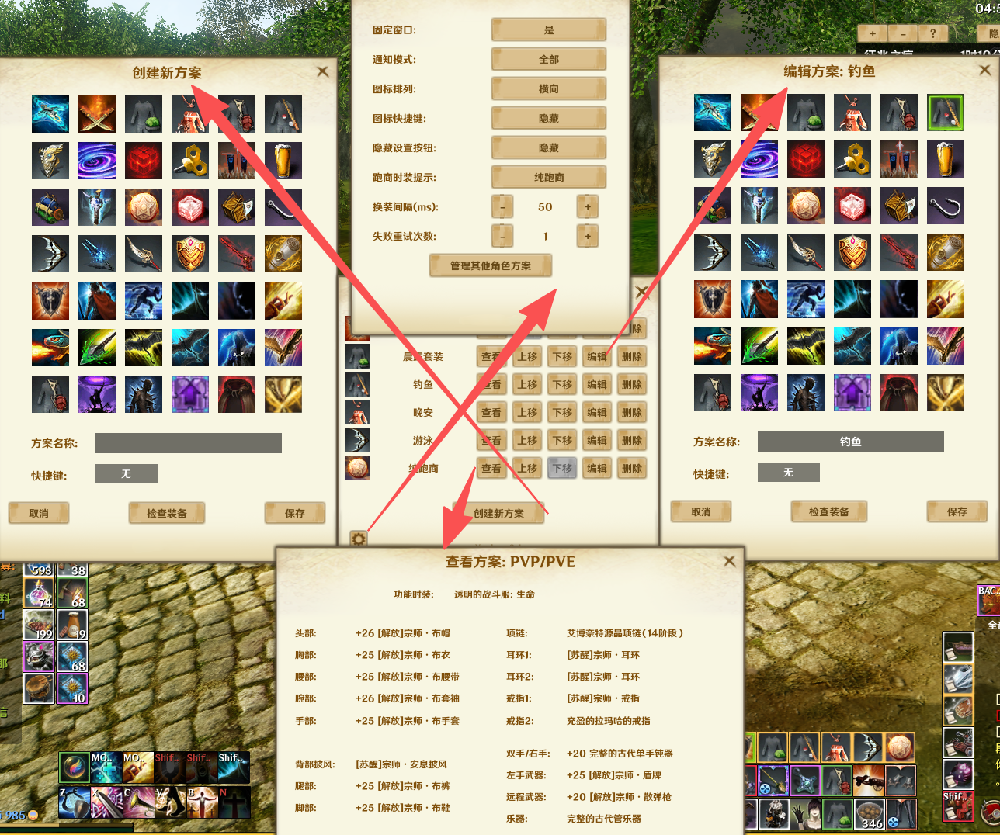</a>
  <a href="https://raw.githubusercontent.com/Yunxei/jingxia/main/assets/screenshots/combatcloset/preview-02.png">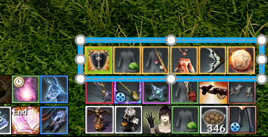</a>
  <a href="https://raw.githubusercontent.com/Yunxei/jingxia/main/assets/screenshots/combatcloset/preview-03.png">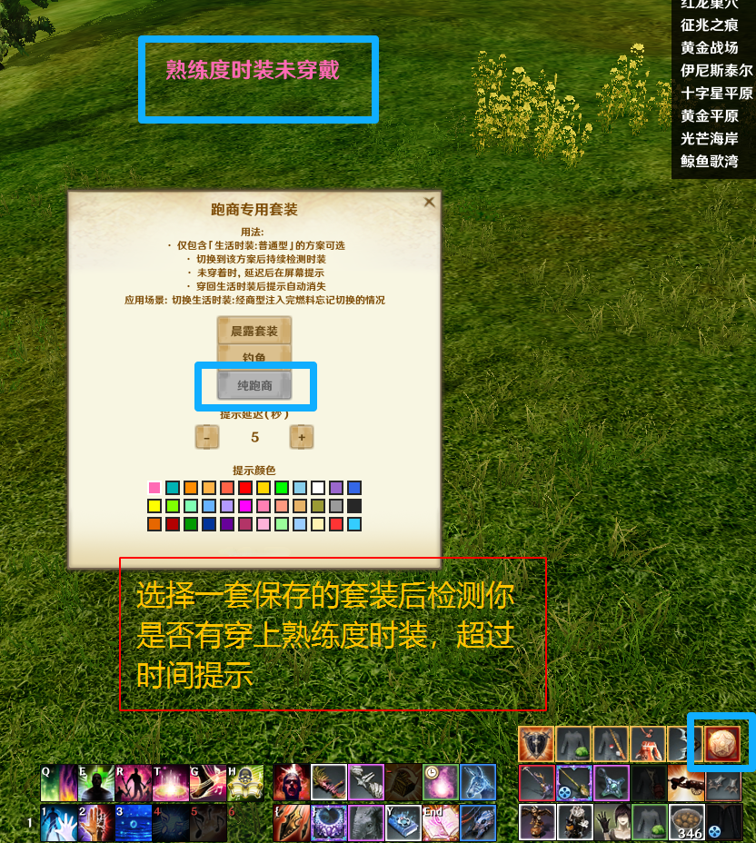</a>
</p>

<picture></picture> **下载**

**combatcloset 2.7**

[](https://github.com/Yunxei/jingxia/releases/download/combatcloset-v2.7/combatcloset-2.7.zip)

<picture></picture> **更新记录**

`2.7`

- 修复保存方案后设置列表未立即更新的问题。

<details>
<summary>历史版本</summary>

`2.6`

- 修复同名装备镶嵌不同宝石时，换装错误选择背包前方装备的问题。
- 已穿戴判断和套装状态识别同步校验宝石签名。
- 兼容现有套装配置，无需重新保存。

`2.5`

- 优化设置与管理窗口：进入下一级时自动隐藏上一层，关闭、取消或按 ESC 后返回上一层。
- 「熟练度时装未穿戴」提示新增实时预览，可直接拖动调整屏幕位置。
- 新增文字大小调整和黑色描边开关，描边默认开启。
- 提示位置、文字大小、颜色和描边选择会自动保存。
- 新增恢复默认，只恢复提示外观，不影响套装、提醒延迟和其他设置。

</details>

</details>

<hr>

<details>
<summary>Angler 1.0 ｜ 钓鱼辅助</summary>

<a id="angler"></a>

<picture></picture> **插件说明**

钓鱼辅助插件，显示当前鱼的动作、较劲、生命值与距离，并记录带头顶标记的死鱼剩余拾取时间。

<picture></picture> **主要功能**

- 鱼的动作与较劲状态显示
- 带头顶标记的死鱼拾取倒计时（180 秒）
- 鱼的生命值与距离显示
- 较劲与拾取倒计时颜色提示
- 可选悬浮窗

<p>
  <a href="https://raw.githubusercontent.com/Yunxei/jingxia/main/assets/screenshots/angler/preview-01.png">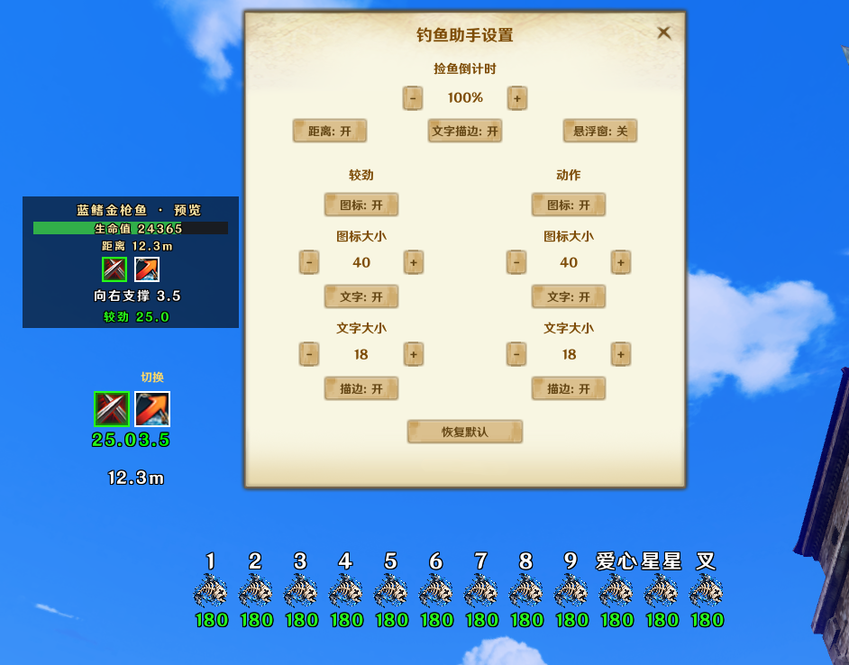</a>
  <a href="https://raw.githubusercontent.com/Yunxei/jingxia/main/assets/screenshots/angler/preview-02.png"></a>
</p>

<picture></picture> **下载**

**Angler 1.0**

[](https://github.com/Yunxei/jingxia/releases/download/angler-v1.0/Angler-1.0.zip)

<picture></picture> **前置插件**

[](https://github.com/Yunxei/jingxia/releases/download/globals/globals.zip)

第一次安装需要同时安装 globals；已经安装过则无需重复安装。

<picture></picture> **更新记录**

`1.0`

当前正式发布版本。

</details>

<hr>

<details>
<summary>Astravia 1.3 Beta ｜ 地图与点位导航</summary>

<a id="astravia"></a>

<picture></picture> **插件说明**

用于地图、资源与自定义点位导航。

内置地图 61 张，点位坐标 ≈4200 个。

地图与图标素材 ≈21MB，代码及坐标数据 ≈2.3MB。

插件体积主要来自素材，文件大小不等同于运行时性能开销。

<picture></picture> **主要功能**

- 沉船、藏宝图、探索点、海虫点及自定义点位导航
- 种植、采集、伐木、采矿、领地资源点与首领分类筛选
- 陈旧的坛子、遗物箱、探险家的背包及打捞、信物点位查询
- 自定义点位导入、当前位置记录、名称与备注管理
- 地图定位、最近传送点推荐及坐标、名称复制

<p>
  <a href="https://raw.githubusercontent.com/Yunxei/jingxia/main/assets/screenshots/Astravia/preview-01.png">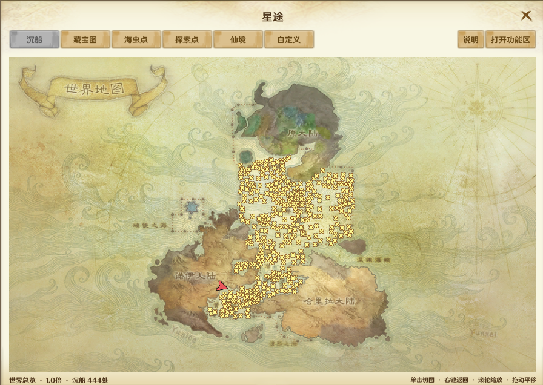</a>
  <a href="https://raw.githubusercontent.com/Yunxei/jingxia/main/assets/screenshots/Astravia/preview-02.png">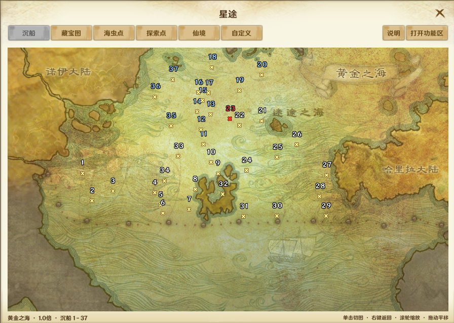</a>
  <a href="https://raw.githubusercontent.com/Yunxei/jingxia/main/assets/screenshots/Astravia/preview-03.png">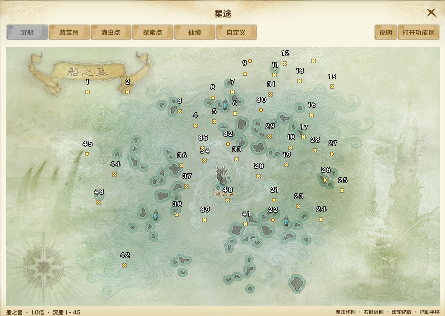</a>
</p>

<p>
  <a href="https://raw.githubusercontent.com/Yunxei/jingxia/main/assets/screenshots/Astravia/preview-04.png">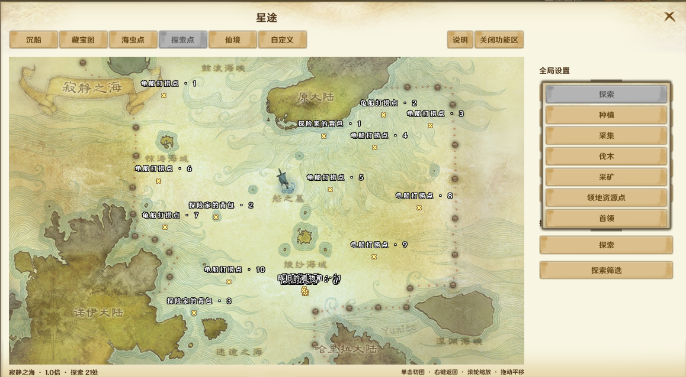</a>
</p>

<picture></picture> **下载**

**Astravia 1.3 Beta**

[](https://github.com/Yunxei/jingxia/releases/download/astravia-v1.3-beta/Astravia-1.3-Beta.zip)

<picture></picture> **前置插件**

[](https://github.com/Yunxei/jingxia/releases/download/globals/globals.zip)

第一次安装需要同时安装 globals；已经安装过则无需重复安装。

<picture></picture> **更新记录**

`1.3 Beta`

- 新增自定义点位：导入坐标、记录当前位置、修改名称和备注、分页管理、删除及导航，点位可保存。
- 新增分类菜单及独立筛选，默认全选，支持全选／全取消及分页。
- 新增种植、采集、伐木、采矿、领地资源点，共3183处。
- 新增龟船打捞点、呼吸耳环信物及呼吸耳环信物Boss房间，共17处。
- 新增首领分类，共15处，包含纳扎尔。
- 新增40条传送点，移除王宫下水道。
- 修复4处已有传送点的坐标及归属数据。
- 优化罗盘：绿色突出主方向，辅助方向渐变，字号随方向变化。
- 优化点位编号：探索、资源和首领按种类、地图固定编号，筛选不会重新编号。
- 优化探索功能区：移除“导航最近点位”按钮。

<details>
<summary>历史版本</summary>

`1.2 Beta`

- 新增说明窗口。
- 新增区域名称支持复制。
- 调整导航信息字号与行距。
- 修复选择标记后导航窗口意外位移。
- 修复导航窗口缩放后的贴边位置恢复。
- 修复挖完藏宝图后未自动切换到下一张导航的问题。

`1.1 Beta`

- 修复探索点筛选窗口的闪退问题，调整弹窗位置及全选／全取消操作。
- 调整地图页签间距，功能区向右展开时保持地图位置不变。
- 重进游戏时地图居中，功能区默认收起。
- 新增导航窗口屏幕四边及角落吸附。
- 新增入口图标显示强度设置。
- 新增导航窗口、地图窗口大小设置，支持实时预览和保存。
- ESC 菜单入口改为“地图坐标插件”，使用地图图标。

`1.0 Beta`

历史测试版本。

</details>

</details>

<hr>

<details>
<summary>LayoutKeeper 1.0 ｜ 界面布局保存与迁移</summary>

<a id="layoutkeeper"></a>

<picture></picture> **插件说明**

保存界面布局，供不同角色、账号或电脑使用。

<picture></picture> **主要功能**

- 保存界面位置及缩放比例
- 布局导出与导入

<p>
  <a href="https://raw.githubusercontent.com/Yunxei/jingxia/main/assets/screenshots/LayoutKeeper/preview-01.png">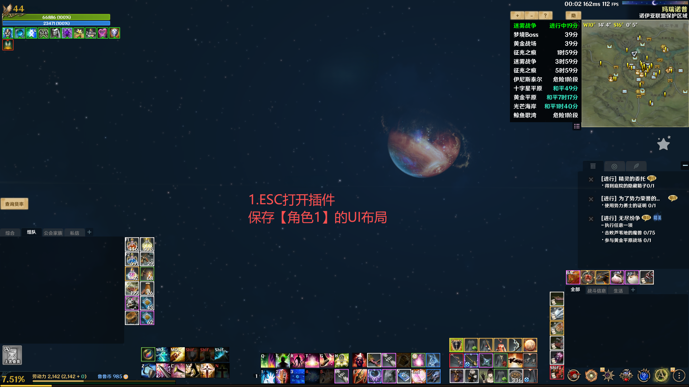</a>
  <a href="https://raw.githubusercontent.com/Yunxei/jingxia/main/assets/screenshots/LayoutKeeper/preview-02.png">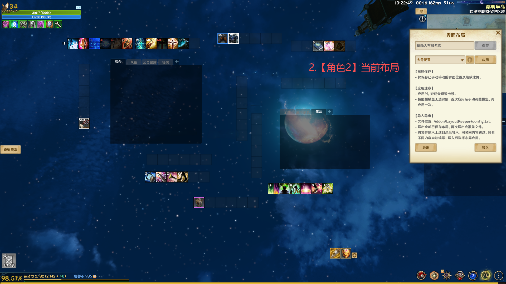</a>
  <a href="https://raw.githubusercontent.com/Yunxei/jingxia/main/assets/screenshots/LayoutKeeper/preview-03.png">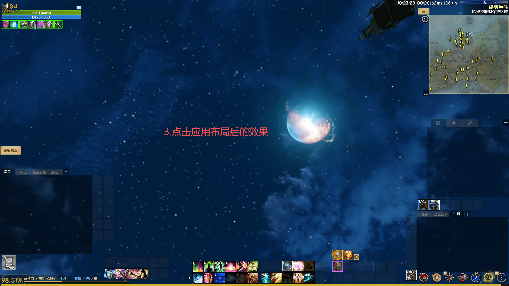</a>
</p>

<picture></picture> **下载**

**LayoutKeeper 1.0**

[](https://github.com/Yunxei/jingxia/releases/download/layoutkeeper-v1.0/LayoutKeeper-1.0.zip)

<picture></picture> **前置插件**

[](https://github.com/Yunxei/jingxia/releases/download/globals/globals.zip)

第一次安装需要同时安装 globals；已经安装过则无需重复安装。

<picture></picture> **更新记录**

`1.0`

当前正式发布版本。

</details>
